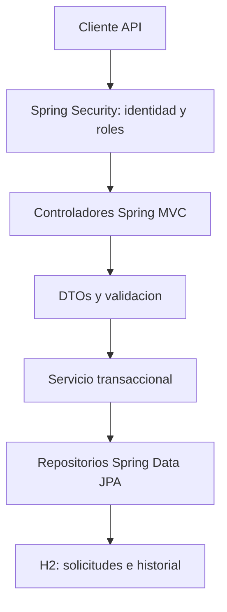

# Arquitectura y reglas

Monolito por capas: un proceso Spring Boot con API REST, sin frontend.
Spring MVC resuelve las peticiones HTTP y serializa DTOs; no hay vistas HTML.

## Responsabilidades

- config: autenticacion, reglas de rutas y proteccion de escrituras.
- controller: contrato HTTP y manejo de errores.
- dto: representaciones de entrada/salida; no se exponen entidades JPA.
- service: permisos por propietario, transiciones, filtros y limites.
- repository: consultas paginadas, especificaciones JPA y persistencia.
- model: solicitudes, tipos, estados y eventos.
- util: exportacion CSV sin archivos compartidos.

## Reglas de negocio

1. Crear siempre asigna PENDING y el usuario de la sesion HTTP autenticada
   (Authentication; no existe sesion persistida en el servidor).
2. Solo el propietario edita o cancela una solicitud pendiente.
3. Solo el supervisor aprueba o rechaza; todas las decisiones requieren comentario.
4. Una decision final no se revierte y no hay borrado fisico por API.
5. Cada creacion, edicion o decision agrega un evento en la misma transaccion.
6. Datos invalidos no generan solicitudes ni eventos parciales.
7. El bloqueo optimista JPA impide que dos escrituras concurrentes sobrescriban una decision.
8. La edicion exige ademas la version leida por el cliente, para detectar formularios desactualizados.
9. Todas las consultas, conteos y exportaciones aplican el alcance del usuario en la base de datos.

## Decisiones y limites

La API utiliza HTTP Basic para autenticar clientes; las claves se codifican
con BCrypt en memoria y se inyectan por entorno, nunca se incluyen en Git.
La configuracion inicial define dos cuentas en memoria, una por rol.
No se habilita CORS ni se ofrece un login web. Una futura interfaz de navegador
necesitaria elegir explicitamente un esquema de sesion y proteccion CSRF apropiados.

Las entidades tienen version y los DTOs impiden que el cliente asigne propietario,
ID, estado o fechas de auditoria. Las modificaciones y su evento son atomicas.

H2 en memoria hace reproducibles las pruebas. El perfil local permite persistir una
base local; ddl-auto=update no sustituye las migraciones versionadas de esquema.

La aplicacion se organiza como un monolito con responsabilidades separadas por capas.
